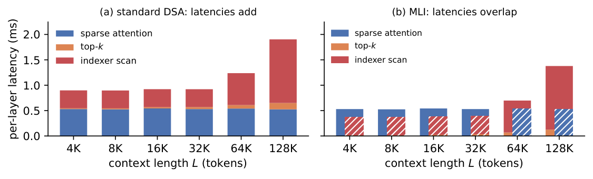

# Multi-layer Indexer (MLI): Overlapping Selection and Attention in DeepSeek Sparse Attention

**Serdarcan Dilbaz, Arjun Krishna, Kiran Kamble, Daniel M. Bikel** — Writer AI Research, Writer, Inc.

*Workshop on Long-Context Foundation Models (LCFM) @ NeurIPS 2026* · [Code](https://github.com/ArjunKrishnak/dsa-multi-layer-indexer) · [Workshop](https://longcontextfm.github.io/) · [Paper (arXiv:2611.03768)](https://arxiv.org/abs/2611.03768)

---

In DeepSeek Sparse Attention (DSA), used by DeepSeek-V3.2 and GLM-5, a *lightning indexer* in front of
every layer scans the whole KV cache and keeps the top-2048 tokens for that layer's attention. At long
context this scan, not the sparse attention it feeds, is where decode time goes, and attention waits on it
at every layer.

Adjacent layers select nearly the same tokens, so **MLI lets a layer attend the selection made by the
previous indexer layer instead of its own**. That removes the dependency: each indexer runs
*concurrently* with its layer's attention, output projection and feed-forward block.

- **No retraining and no new weights.** Every indexer still runs and still computes a fresh selection; only which layer consumes it changes.
- **No kernel change needed.** The default realization runs the indexer on a second CUDA stream inside SGLang's production decode CUDA graph. An optional fused decode kernel speeds it up further on DeepSeek-V3.2.
- **Composes with IndexCache.** IndexCache (GLM-5.2's IndexShare) drops indexers from some layers; MLI hides the scan on the rest. At retention 1/4 and 128K tokens, IndexCache + MLI reaches **1.32×** the unmodified DeepSeek-V3.2 decode throughput, above IndexCache's **1.28×** at 1/8, while keeping twice as many fresh selections.

<p align="center"></p>
<p align="center"><em>Per-layer DSA decode latency (DeepSeek-V3.2, H100). (a) Standard DSA: indexer and attention latencies add.
(b) MLI: they overlap. This is the idealized ceiling; the gain realized when serving is bandwidth-bound (paper Sec. 5.2).</em></p>

## Contents

- [Results at a glance](#results-at-a-glance)
- [Repository layout](#repository-layout)
- [Installation](#installation)
- [Quick start: serve a model with MLI](#quick-start-serve-a-model-with-mli)
- [Configuration reference](#configuration-reference)
- [Reproducing the paper](#reproducing-the-paper)
- [Tests](#tests)
- [Citation](#citation)
- [License and acknowledgements](#license-and-acknowledgements)

## Results at a glance

Per-request decode throughput (one concurrent request, 8×H200, TP=8, fp8 KV cache), as % change over
the unmodified model at the same context. Full tables are in the paper (Table 1).

| DeepSeek-V3.2, 128K | IndexCache | IndexCache + MLI |
|---|---:|---:|
| all layers keep an indexer | — | **+25.1** |
| retention 1/2 | +13.7 | **+29.8** |
| retention 1/4 | +22.7 | **+32.3** |
| retention 1/8 | +28.0 | **+33.7** |

| GLM-5, 195K | IndexCache | IndexCache + MLI |
|---|---:|---:|
| all layers keep an indexer | — | **+16.8** |
| retention 1/2 | +10.6 | **+21.4** |
| retention 1/4 | +17.7 | **+23.7** |
| retention 1/8 | +21.3 | **+25.0** |

LongBench, LongBench v2 and RULER accuracy stays within a few points of IndexCache at the same
retention. At aggressive retention, distilling only the indexers (about 0.5% of parameters) prevents
the quality collapse IndexCache shows.

## Repository layout

```
sglang_overlay/
  mli-sglang-v0.5.16.patch   # The method: patch on SGLang v0.5.16 (pure Python, no kernel rebuild)
kernels/
  cuda_fused_sparse_splitk.py # Fused sparse-MLA + indexer-scan decode kernel (JIT-built; DeepSeek-V3.2)
src/lagged_indexer_dsa/       # Python package
  dsa_layer.py, model.py      #   Pure-PyTorch DSA reference + lagged schedules (CPU-testable)
  distill/                    #   Indexer-only distillation (KL + ListMLE "hybrid" objective)
  inference/                  #   Checkpoint loader + reference forward used by distillation
  ruler_gen.py, served_eval.py#   RULER generator and answer extraction for the served evals
eval/                         # Clients that score a running server
  eval_longbench_served.py    #   LongBench (11 English tasks)
  eval_longbench_v2_served.py #   LongBench v2 (503 MCQ)
  eval_ruler_served.py        #   RULER (needle / variable tracking / common words)
  eval_needle.py              #   Multi-needle retrieval
  eval_decode_ppl.py          #   Perplexity of the model's own greedy continuation
  validate_serving_run.py     #   Protocol gates (drift, engagement markers)
scripts/
  setup/                      #   Container import, SGLang + overlay, LongBench data, weight staging
  speed.sbatch                #   Decode-throughput cell (all arms in one job)
  quality.sbatch              #   Quality runner (all evals per arm)
  distill/                    #   Distillation jobs (single run + paper sweep launcher)
tests/                        # CPU unit tests
```

The overlay and the Python package carry some code paths for related variants we explored (for example
token re-ranking and admission on reused layers, under `index_reuse_*`, `tap` and `cascade` names). They
are off by default, the configurations below never enable them, and they are not part of the paper.

## Installation

```bash
git clone https://github.com/ArjunKrishnak/dsa-multi-layer-indexer.git
cd dsa-multi-layer-indexer
```

There are two parts, and you only need the ones you use.

**1. Serving stack (to run MLI).** We serve with the stock SGLang v0.5.16 container plus our overlay:

```bash
# SGLang v0.5.16 source with the MLI overlay applied
scripts/setup/prepare_sglang.sh /path/to/sglang-mli

# Container (any of these):
docker pull lmsysorg/sglang:v0.5.16-cu130
WORK=/path/to/workspace sbatch scripts/setup/import_image.sbatch   # enroot/pyxis clusters -> $WORK/sglang-v0.5.16-cu130.sqsh
```

The overlay is pure Python, so it can be mounted over the container's installed `sglang` package (this
is what our scripts do) or installed from the patched clone with `pip install -e /path/to/sglang-mli/python`.
`sgl-kernel` is the stock public `sgl-kernel==0.4.5`.

**2. Python package (distillation, reference implementation, evaluation helpers, tests).**

```bash
uv sync          # or: pip install -e .
```

The fused kernel and the distillation build CUDA extensions on first use. This needs an `nvcc`
matching torch's CUDA build (CUDA 13.0 for the locked `torch==2.12.1+cu130`), via `CUDA_HOME`. Distillation
also needs `fast-hadamard-transform`, which `scripts/distill/distill_indexer.sbatch` installs automatically.

Weights: [`deepseek-ai/DeepSeek-V3.2`](https://huggingface.co/deepseek-ai/DeepSeek-V3.2) and
[`zai-org/GLM-5-FP8`](https://huggingface.co/zai-org/GLM-5-FP8) (FP8 checkpoints).

## Quick start: serve a model with MLI

MLI is selected per server through `--json-model-override-args`. On one 8-GPU node, inside the container
with the overlay installed:

```bash
# Common server flags used throughout the paper
FLAGS="--model-path /path/to/DeepSeek-V3.2 --trust-remote-code --tp-size 8 \
  --dsa-prefill-backend flashmla_sparse --dsa-decode-backend flashmla_kv --kv-cache-dtype fp8_e4m3 \
  --cuda-graph-max-bs-decode 4 --cuda-graph-bs-decode 1 2 4"

# MLI, deferred-stream realization (no kernel change; works on DeepSeek-V3.2 and GLM-5)
HH_LAG_NO_ALT=1 python -m sglang.launch_server $FLAGS --json-model-override-args \
  '{"index_topk_freq": 1, "index_reuse_lag_refresh": true, "index_reuse_lag_refresh_deferred": true}'

# IndexCache at retention 1/4 + MLI
HH_LAG_NO_ALT=1 python -m sglang.launch_server $FLAGS --json-model-override-args \
  '{"index_topk_freq": 4, "index_reuse_lag_refresh": true, "index_reuse_lag_refresh_deferred": true}'

# MLI, fused-kernel realization (DeepSeek-V3.2 only; needs kernels/ on PYTHONPATH)
PYTHONPATH=$REPO/src:$REPO/kernels:$PYTHONPATH \
HH_HIDE_DEFER_SCAN=1 HH_HIDE_DEFER_NOJOIN=1 HH_HIDE_EARLY_PREP=1 HH_HIDE_NSPLIT=64 \
python -m sglang.launch_server $FLAGS --json-model-override-args \
  '{"index_topk_freq": 4, "index_lag_fused": true}'
```

Add `--reasoning-parser glm45` for GLM-5. Once a server has captured MLI into its decode graph, the log
prints a `first 'lag_refresh_deferred'` (deferred) or `first 'hide_fused'` (fused) marker. If the marker
is missing, the server is running the standard schedule. The server exposes SGLang's usual
OpenAI-compatible API.

Both realizations attend exactly the selections that the production top-k kernel would produce one
indexer layer earlier, so accuracy does not depend on which realization you pick.

## Configuration reference

JSON overrides (`--json-model-override-args`):

| Key | Meaning |
|---|---|
| `index_topk_freq` | IndexCache uniform retention: run the indexer on 1 of every *F* layers (stock SGLang). `1` = every layer. |
| `index_topk_pattern` | IndexCache explicit pattern, one `F` (run indexer) / `S` (share) per layer (stock SGLang). |
| `index_reuse_lag_refresh` | Enable MLI: full layers attend the selection of the previous full layer. |
| `index_reuse_lag_refresh_deferred` | Run each indexer on a second CUDA stream, joined by the consuming layer (the deferred-stream realization). |
| `index_reuse_lag_depth` | Lag depth *k* (default 1). The paper finds *k* = 2, 3 change nothing. |
| `index_lag_fused` | Use the fused sparse-attention + indexer-scan decode kernel (DeepSeek-V3.2). |
| `index_distilled_weights` | Path to a distillation payload; replaces only the retained layers' indexer weights at load time. |

Environment variables:

| Variable | Meaning |
|---|---|
| `HH_LAG_NO_ALT=1` | Dispatch the deferred indexer from the serial branch (avoids small graph bubbles). Used for all deferred-stream speed numbers in the paper. |
| `HH_HIDE_DEFER_SCAN=1 HH_HIDE_DEFER_NOJOIN=1 HH_HIDE_EARLY_PREP=1` | Fused-kernel schedule used for the paper's DeepSeek-V3.2 numbers. |
| `HH_HIDE_NSPLIT` | Fused-kernel split factor (paper: `64`). |
| `HH_LAG_STREAM_PRIORITY` | Side-stream priority (ablation; no effect; paper Sec. 5.2). |

## Reproducing the paper

The paper's experiments ran on Slurm with [pyxis](https://github.com/NVIDIA/pyxis)/enroot containers, on
one 8×H200 node per job. The scripts take every path from the environment; submit from the repo root:

```bash
export WORK=/path/to/workspace                  # caches, results; mounted at /hh in the container
export SGLANG_SRC=/path/to/sglang-mli           # from scripts/setup/prepare_sglang.sh
export MODEL_PATH=/path/to/DeepSeek-V3.2        # or GLM-5-FP8
# optional: SQSH (default $WORK/sglang-v0.5.16-cu130.sqsh), STAGE_DIR (copy weights to local disk first)
```

**Decode throughput (Table 1, saturation tables).** Each job boots every arm (base, IndexCache at each
retention, IndexCache + MLI, base again) on the same node, so differences reflect only the method:

```bash
MODEL_TAG=ds   CTX=131072 sbatch -p <partition> scripts/speed.sbatch                   # DeepSeek-V3.2, fused kernel
MODEL_TAG=glm5 CTX=199680 INCLUDE_FUSED=0 sbatch -p <partition> scripts/speed.sbatch   # GLM-5, deferred stream
MODEL_TAG=glm5 CTX=199680 INCLUDE_FUSED=0 SEARCHED=1 sbatch ...                        # + IndexCache searched patterns
MODEL_TAG=ds   CTX=131072 REGIME=saturation sbatch ...                                 # full-KV-cache regime
```

Results go to `$WORK/results/grid_<model>_<regime>_<ctx>_<job>/` with one `.jsonl` per arm plus server
logs. `validation.json` records the protocol gates: base-vs-base drift ≤ 2% and an engagement marker for
every MLI arm on every rank. The job exits non-zero if a gate fails.

**Quality (Sec. 5.4–5.6).** Fetch the LongBench summarization tasks once (`WORK=... scripts/setup/fetch_longbench_summ.sh`), then:

```bash
MODEL_TAG=ds ARMS="base lag_fused ic_f2 ic_lag_fused_f2 ic_f4 ic_lag_fused_f4" \
  RULER_N=3 LBV2_MAX_SAMPLES=0 sbatch -p <partition> scripts/quality.sbatch
```

The arm names are documented at the top of `scripts/quality.sbatch`. In the quality runner, arms named
`lag_fused` use the deferred stream; their selections are identical to the fused kernel's.

**Distillation (Sec. 3.3).** Each run trains only the retained layers' indexers (300 steps, GovReport, two
8-GPU nodes). This dry run prints every job used in the paper; add `--submit` to launch:

```bash
DS_CKPT=/path/DeepSeek-V3.2 GLM_CKPT=/path/GLM-5-FP8 WORK=$WORK SBATCH_ARGS="-p <partition>" \
  scripts/distill/launch_distill.sh
```

Payloads are written to `$WORK/distill/`, which `scripts/quality.sbatch` mounts; the `*_d_*` arms serve them.

## Tests

```bash
uv run pytest
```

The tests run on CPU. They check that the lagged schedule is exactly equivalent to its fused reformulation
(fp64) and preserves causality, plus the distillation losses, RoPE, and the RULER and answer-extraction
helpers. To check the fused kernel on a GPU (H100/H200) against its reference:

```bash
CUDA_HOME=/usr/local/cuda-13.0 PYTHONPATH=src uv run python kernels/cuda_fused_sparse_splitk.py --skv 4096 16384 --nsplit 16 64
# -> "VALIDATION OK", then fused-vs-serial timings
```

## Citation

If you use this code, please cite:

```bibtex
@inproceedings{dilbaz2026mli,
  title         = {Multi-layer Indexer: Overlapping Selection and Attention in DeepSeek Sparse Attention},
  author        = {Dilbaz, Serdarcan and Krishna, Arjun and Kamble, Kiran and Bikel, Daniel M.},
  booktitle     = {NeurIPS 2026 Workshop on Long-Context Foundation Models},
  year          = {2026},
  eprint        = {2611.03768},
  archivePrefix = {arXiv},
  primaryClass  = {cs.LG},
  url           = {https://arxiv.org/abs/2611.03768}
}
```

## License and acknowledgements

Released under the Apache License 2.0 (see `LICENSE` and `NOTICE`). The overlay patches
[SGLang](https://github.com/sgl-project/sglang) (Apache-2.0). `src/lagged_indexer_dsa/tilelang_dsa/` is
adapted from the [TileLang](https://github.com/tile-ai/tilelang) DeepSeek-V3.2 examples (MIT), and the
reference FP8 indexer kernel follows [DeepSeek-V3.2-Exp](https://github.com/deepseek-ai/DeepSeek-V3.2-Exp)'s
inference code (MIT). We compare against and compose with
[IndexCache](https://arxiv.org/abs/2603.12201), using its released SGLang layer-skip knobs.
